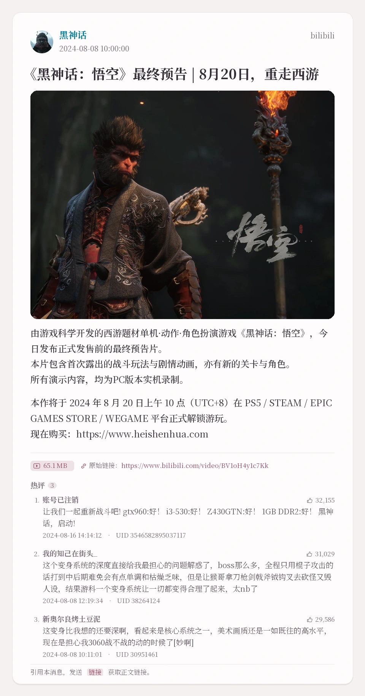
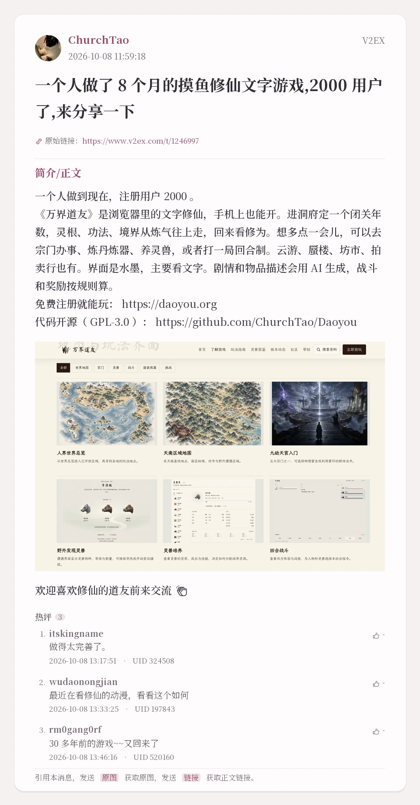

# 流媒体聚合解析器

**把聊天里的平台链接，变成可直接阅读和发送的媒体内容。**

视频 · 音频 · 图片 · 图文 · 热评

[快速开始](#quick-start) · [支持平台](#platforms) · [默认行为](#defaults) · [常用配置](#settings) · [卡片效果](#card-examples) · [高级功能](#advanced)

---

## 🚀 快速开始

1. 在 AstrBot 4.x WebUI 的插件市场搜索 `astrbot_plugin_media_parser` 并安装。
2. 在聊天中发送一个支持的平台链接。默认自动解析，可直接收到正文和可获取的媒体。
3. 如果想把正文和热评合成图片，在 **消息输出 → 文本元数据** 中开启 **将文本元数据渲染为图片**。

Docker 部署需留意媒体缓存目录。AstrBot 与协议端分开运行时，请先查看下方「高级功能」中的缓存与中转说明。

## 🌐 支持平台

支持视频、音频、图片、图文和热评等内容。具体能力会因平台和链接类型有所不同。

|  |  |  |  |
| --- | --- | --- | --- |
| B站 | 抖音 | 快手 | AcFun |
| 红果短剧 | 网易云音乐 | 喜马拉雅 | 微博 |
| 小红书 | 闲鱼 | 今日头条 | 小黑盒 |
| 雪球 | 酷安 | 微信 | 知乎 |
| 百度贴吧 | NGA | 虎扑 | 豆瓣 |
| V2EX | 稀土掘金 | CSDN | 博客园 |
| Gitee | TikTok | YouTube | Steam |
| Twitter/X | Pixiv | GitHub | GitLab |

## ⚙️ 默认行为

| 配置 | 默认值 | 说明 |
| --- | --- | --- |
| 自动解析 | 开启 | 发送链接后自动处理 |
| 文本与富媒体输出 | 均开启 | 同时发送正文和媒体 |
| 正文配图按原文顺序穿插 | 开启 | 支持的平台按阅读顺序发送 |
| 热评 | 3 条 | 可按平台排除 |
| 文本元数据渲染为图片 | 关闭 | 开启后生成文字卡或分享卡 |
| 卡片版式 | 分享卡 | 可切换为文字卡 |
| 卡片主题 | 玫瑰便签 | 另有雾灰简约、深蓝磨砂、浅棕细纹纸 |
| 卡片字体 | 思源宋体 | 另有思源黑体、霞鹜文楷 |
| 正文、热评与翻译分区渲染 | 关闭 | 默认合并到同一张卡片 |
| 长图自动分页 | 关闭 | 开启后超过 1800 像素时分页 |

## 🧭 常用配置

### 按平台选择发送内容

在 **平台开关与输出模式** 中分别选择「发送文本的平台」和「发送富媒体的平台」。两项都选会发送正文和媒体。只选文本可跳过媒体下载，只选富媒体则仅发送图片、音频或视频。想保留图文帖的正文、同时让视频帖只发视频，可将对应平台加入「有视频时只发富媒体」。

### 热评、配图与音频

- **热评**　在「消息输出 → 附加内容：热评」中设置条数，填 `0` 关闭，也可排除指定平台。内容可能是评论、游戏评价、Issue 讨论或分集弹幕，实际条数取决于来源。
- **正文配图**　在「消息输出 → 富媒体展示」中开启「正文与配图按原文顺序穿插」，并保留正文与富媒体输出。有图片位置的文章会交替发送段落和配图，生成分享卡时也沿用该顺序。
- **图集与音频**　在同一处可将普通图集设为多图一条或逐张发送，音频可选语音或原始文件。语音转换需要 ffmpeg。

### 卡片与引用

在 **消息输出 → 文本元数据** 中选择分享卡或文字卡，并独立调整主题和字体。分享卡可展示封面与图集。开启「展开排版设置」后，可调整字号和间距，或让正文、热评和翻译分别出图。只想按长度拆分时，直接开启「长图自动分页」，此项也作用于仓库 README 截图。

引用机器人发送的分享卡，根据卡片底部提示发送关键词。默认有效期为一小时，关键词可自定义。

| 发送 | 可取回的内容 |
| --- | --- |
| `原图` | 图集、正文配图，以及替代视频发送的封面。随视频展示的封面仅作预览。 |
| `链接` | 正文中出现的网址及说明，按原文顺序返回。 |

## 🖼️ 卡片效果

两张示例均使用玫瑰便签、思源宋体，附三条热评。点击图片可查看原尺寸。

| 视频 · 《黑神话：悟空》最终预告 | 图文 · 《万界道友》开发分享 |
| :---: | :---: |
|  |  |
| [B 站原视频](https://www.bilibili.com/video/BV1oH4y1c7Kk) | [V2EX 原帖](https://www.v2ex.com/t/1246997) |

## 🧰 高级功能

展开高级配置和运行前提

### 缓存目录

非 Docker 环境默认使用 AstrBot 插件数据目录。Docker 环境建议配置协议端可以访问的共享缓存目录。图片、独立音频、部分视频流和 B站高画质通常需要缓存。

### B站高画质

在「B站增强」中启用 Cookie 并填写凭据。高画质、Cookie 续期和部分视频流需要可用缓存目录，管理员协助登录还需要配置管理员 ID。

### 翻译与内容总结

在「文本翻译与内容总结」中选择模型和内容类型。功能默认关闭，模型不可用时保留原始解析结果。

### 仓库 README 截图

GitHub、GitLab 和 Gitee 可发送仓库概况与 README 截图。截图功能需要在 AstrBot 所用的 Python 环境中安装 Playwright Chromium。

    python -m playwright install chromium

### 媒体中转

当 AstrBot 与协议端无法共享文件目录时，可在「媒体中转」中开启临时链接发送。媒体中转仍需要本地缓存目录。

### 引用和归档

在「消息输出」中配置「引用链接归档命令」后，引用链接消息并发送该命令，可将解析结果和已下载的媒体打包为 ZIP。

## 🛠️ 常见限制

- 私密、删除、付费、登录限制和风控内容可能无法解析。
- TikTok、YouTube、Twitter/X、Pixiv、小黑盒和 Steam 的部分请求可能需要代理。
- 微信视频号短链需要腾讯元宝 Cookie，公众号文章无需填写。
- 语音、视频解密和图片转换可能需要 ffmpeg。
- 机器人会跳过自身消息，直播链接默认跳过。
- 缓存目录不可用时，必须下载到本地的媒体会被跳过，但文本通常仍会发送。

## 📚 更多资料

| 文档 | 内容 |
| --- | --- |
| [更新日志](CHANGELOG.md) | 版本变化 |
| [平台解析备忘](docs/PARSER_METHOD_MEMO.md) | 链接范围和平台边界 |
| [架构说明](docs/ARCHITECTURE.md) | 模块职责和运行流程 |
| [字体资源说明](resource/font/README.md) | 字体来源、许可证和补全方式 |

## 📄 许可证

本项目使用 AGPL-3.0 许可证。字体资源遵循各自许可证，详见[字体资源说明](resource/font/README.md)。
